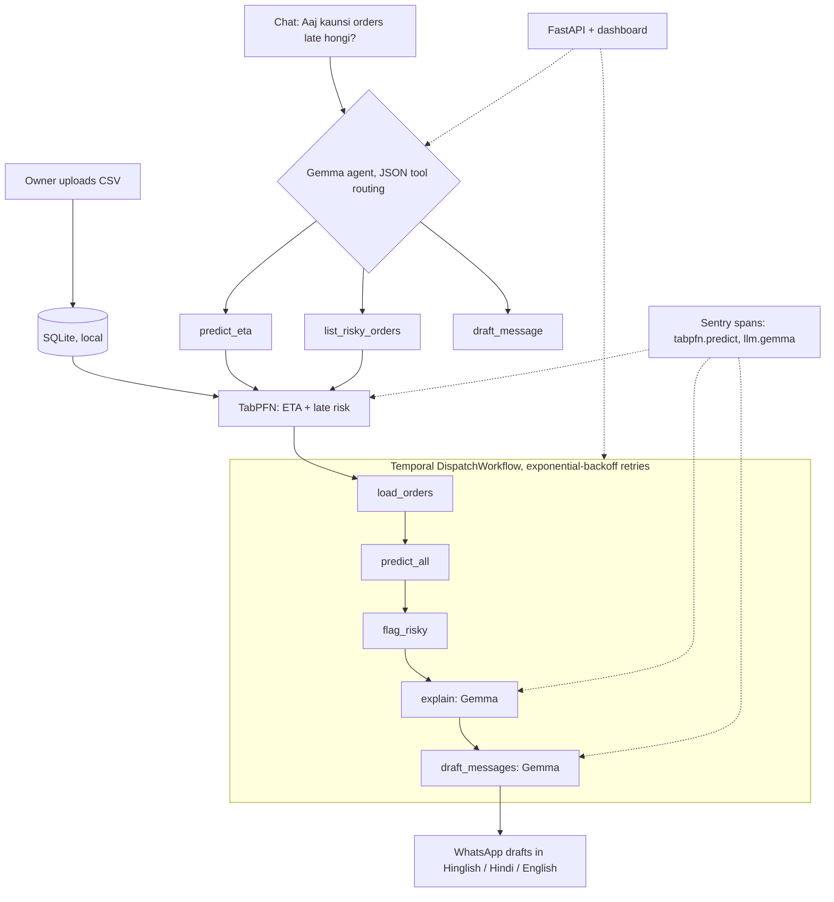
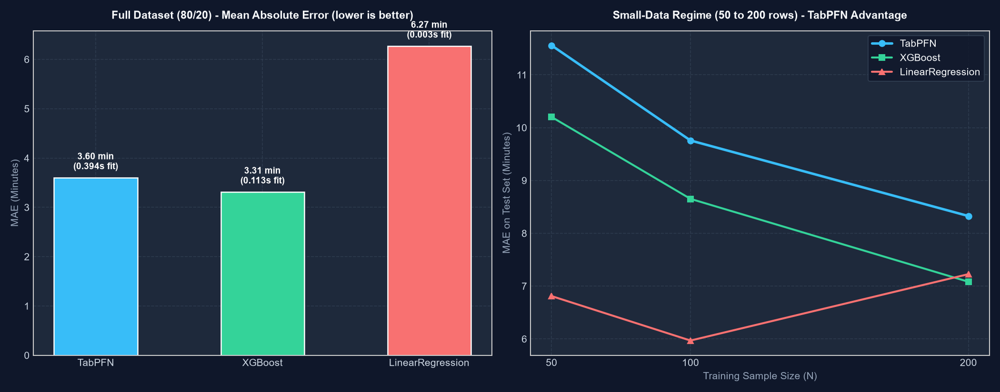

<div align="center">

# 🍱 DabbaETA

### Local-first delivery-time prediction and dispatch assistant for tiffin services, bakeries and local couriers.

**Know which orders will be late *before* the customers call. Customer data never leaves the laptop.**


*Built for the DEV HF26 "Side Hustle" challenge.*

</div>

---

## Table of contents

- [The problem](#the-problem)
- [What it does](#what-it-does)
- [Architecture](#architecture)
- [Why open](#why-open)
- [Quick start](#quick-start)
- [Configuration](#configuration)
- [Using it](#using-it)
- [API reference](#api-reference)
- [Benchmark](#benchmark)
- [The Gemma agent](#the-gemma-agent)
- [Temporal workflow](#temporal-workflow)
- [Observability with Sentry](#observability-with-sentry)
- [Testing](#testing)
- [Project structure](#project-structure)
- [Assumptions](#assumptions)
- [Limitations](#limitations)
- [Licensing note](#licensing-note)
- [Roadmap](#roadmap)

---

## The problem

A small tiffin kitchen runs the same crisis every day: it starts raining, one rider is new, eight orders go out together, and by 1 PM customers are calling to ask where their food is.

The owner has months of delivery history in a notebook or spreadsheet that nobody has ever used to see this coming. Large platforms have ML teams for it. A 40-order kitchen does not, and does not want to upload customer names, phone numbers and addresses to a third-party SaaS.

**DabbaETA is the version that runs on the laptop they already own.**

## What it does

| Capability | How |
|---|---|
| **Upload history** | Drop in a CSV of past deliveries. The schema is validated and stored in a local SQLite file. |
| **Predict ETA and late risk** | TabPFN predicts delivery time for every pending order and flags each as HIGH / MODERATE / LOW risk. |
| **Ask in plain language** | Chat with a local Gemma agent: *"Aaj kaunsi orders late hongi?"* |
| **Draft customer messages** | Polite delay notices in Hinglish, Hindi or English, ready to copy into WhatsApp. |
| **One-click dispatch run** | A Temporal workflow runs load → predict → flag → explain → draft, with retries on failure. |
| **Compare models** | Built-in benchmark: TabPFN vs XGBoost vs linear regression, including small-data runs. |
| **See where time goes** | Sentry spans on every Gemma and TabPFN call, with latency and token counts. |

## Architecture



**Predictor interface.** All models implement an abstract `BasePredictor` (`app/baselines.py`). `TabPFNPredictor` (`app/predictor.py`) supports both the `tabpfn-client` API and the local `tabpfn` package, so models can be swapped without touching the rest of the app.

## Why open

- **Customer data stays put.** Names, phones and addresses never reach an LLM API. Gemma runs locally through Ollama. The only data sent off the machine is a table of numeric features (distance, traffic, weather, prep time) to TabPFN, and the local `tabpfn` package removes even that.
- **No per-message bill.** Every ETA question and drafted message on a metered API costs money, which matters on a small kitchen's margin. Locally, the marginal cost is zero.
- **Swap the model in one line.** Set `OLLAMA_MODEL` to any model Ollama serves. No code change.
- **No lock-in.** No vendor pricing change can break an owner's daily workflow.

## Quick start

### Prerequisites

- Python 3.11+
- [Ollama](https://ollama.com) installed and running
- [Temporal CLI](https://docs.temporal.io/cli) (optional, for the real workflow engine; without it the app falls back to an in-process run)
- A TabPFN API key from [platform.priorlabs.ai](https://platform.priorlabs.ai) (free, non-commercial licence), or use the local `tabpfn` package

### Setup

```bash
# 1. Clone
git clone https://github.com/Harsh63870/DabbaWala.git
cd DabbaWala

# 2. Create environment and install dependencies
python -m venv .venv
source .venv/bin/activate        # Windows: .venv\Scripts\activate
pip install -r requirements.txt

# 3. Configure
cp .env.example .env
# edit .env and add your TABPFN_API_KEY (and optionally SENTRY_DSN)

# 4. Pull the local LLM
ollama pull gemma3:4b

# 5. Generate the dataset
python scripts/make_dataset.py
```

### Run

```bash
make dev
# or: uvicorn app.main:app --host 0.0.0.0 --port 8000 --reload
```

Open **http://localhost:8000** for the dashboard.

### Run with the real Temporal engine (recommended)

In separate terminals:

```bash
# Terminal 1: Temporal dev server (UI at http://localhost:8233)
temporal server start-dev

# Terminal 2: the workflow worker
python -m workflows.worker

# Terminal 3: the app
make dev
```

The worker listens on the task queue `dabbaeta-dispatch-queue`. If Temporal is not reachable, `POST /run-dispatch` falls back to an in-process run so the demo still works.

## Configuration

All secrets and settings come from environment variables. Nothing is hardcoded.

| Variable | Purpose | Default |
|---|---|---|
| `TABPFN_API_KEY` | API key for `tabpfn-client` | none |
| `OLLAMA_MODEL` | Model served by Ollama | `gemma3:4b` |
| `SENTRY_DSN` | Enables Sentry tracing when set | none |

Check `.env.example` for the full, current list.

## Using it

1. **Orders tab.** Live queue with ETA and risk badges, a search filter, a model switch dropdown and a quick WhatsApp-draft action.
2. **Chat tab.** Talk to the Gemma agent. Quick-prompt chips include *"Aaj kaunsi orders late hongi?"*.
3. **Benchmark tab.** Metrics table, small-data insights and the benchmark chart.
4. **⚡ Run Dispatch.** Starts the Temporal workflow, shows a five-step progress stepper, a short Gemma diagnosis of the bottlenecks, and drafted messages with Copy and Open-in-WhatsApp buttons.

A 2-minute walkthrough script is in [`docs/DEMO.md`](docs/DEMO.md).

## API reference

| Method | Endpoint | Description |
|---|---|---|
| `POST` | `/upload` | Upload a CSV. Validates the schema, fills missing delivery columns, stores in SQLite. |
| `POST` | `/predict` | Returns ETA (minutes) and late-risk estimate with a confidence interval for an order. |
| `GET` | `/benchmark` | Returns benchmark metrics and the chart URL. |
| `POST` | `/chat` | Sends a message to the Gemma agent. |
| `POST` | `/run-dispatch` | Starts `DispatchWorkflow`. |
| `GET` | `/run-dispatch/{id}` | Returns workflow status and results. |

FastAPI's interactive docs are available at **http://localhost:8000/docs**.

## Benchmark

> **Read this first:** the dataset is **synthetic** (5,000 orders, same schema as the Kaggle *Food Delivery Times* dataset, with simulated vehicle speeds, monsoon and fog delays, evening rush and courier-experience effects). These numbers check that the pipeline works. They are **not** a claim about any real kitchen.

Reproduce:

```bash
python scripts/benchmark.py
```

Results are written to [`docs/benchmark.json`](docs/benchmark.json) and [`docs/benchmark.png`](docs/benchmark.png).

**Full data (4,000 train / 1,000 test):**

| Model | MAE (min) | RMSE | R² | Fit time | Predict time |
|---|---|---|---|---|---|
| TabPFN | 3.60 | 6.05 | 0.937 | 0.394 s | 0.004 s |
| XGBoost | **3.31** | **5.22** | **0.953** | 0.113 s | 0.006 s |
| Linear regression | 6.27 | 10.15 | 0.822 | 0.003 s | < 0.001 s |

**With thousands of rows, XGBoost is the most accurate.** Both tree-based and foundation-model approaches are far ahead of linear regression, which makes sense because delivery time depends on interactions such as distance × traffic × weather.

The script also runs a **small-data experiment** (50, 100 and 200 training rows), because a small owner has weeks of history, not thousands of rows. See `docs/benchmark.json` for those results. Because the predictor is swappable, you can choose whichever model fits your data size.



## The Gemma agent

Small local models are unreliable at native tool-calling, so the agent does not depend on it.

- Gemma is prompted to emit strict JSON: `{"tool": "...", "args": {...}}`.
- The reply is parsed with regex extraction, with an automatic retry loop on malformed output.
- A heuristic router handles common queries (including Hinglish ones like *"Aaj kaunsi orders late hongi?"*) when the model's JSON is unusable.

| Tool | Purpose |
|---|---|
| `predict_eta(order)` | ETA and risk for a single order |
| `list_risky_orders(threshold)` | Pending orders above a risk threshold |
| `draft_message(order, language)` | Delay message in Hinglish, Hindi or English |

Code: [`app/agent.py`](app/agent.py), [`app/tools.py`](app/tools.py).

## Temporal workflow

`DispatchWorkflow` chains five activities:

```
load_orders → predict_all → flag_risky → explain → draft_messages
```

Each activity has exponential-backoff retries, so one flaky model call does not mean redoing the whole run. Code lives in [`workflows/`](workflows/) (`workflows.py`, `activities.py`, `worker.py`). Inspect runs in the Temporal UI at http://localhost:8233.

## Observability with Sentry

Set `SENTRY_DSN` to enable tracing. Custom spans wrap every model call:

| Span | Wraps | Recorded |
|---|---|---|
| `llm.gemma` | Every Gemma call | `latency_ms`, `tokens_in`, `tokens_out` |
| `tabpfn.predict` / `tabpfn.fit` | TabPFN calls | latency |

Spans are emitted from the FastAPI app and from the Temporal activities.

## Testing

```bash
pytest -v
```

Eight tests cover:

- order schema validation (valid and invalid)
- predictor interface
- agent JSON tool extraction
- Hindi/Hinglish query routing
- message drafting tool
- workflow happy path
- API endpoints

## Project structure

```
DabbaWala/
├── app/
│   ├── main.py          # FastAPI app and endpoints
│   ├── predictor.py     # TabPFNPredictor (client + local)
│   ├── baselines.py     # BasePredictor, XGBoost, Linear Regression
│   ├── agent.py         # Gemma JSON tool-routing agent
│   ├── tools.py         # predict_eta, list_risky_orders, draft_message
│   └── schemas.py       # Pydantic models
├── workflows/
│   ├── workflows.py     # DispatchWorkflow
│   ├── activities.py    # Temporal activities
│   └── worker.py        # Worker on dabbaeta-dispatch-queue
├── scripts/
│   ├── make_dataset.py  # Synthetic dataset generator
│   └── benchmark.py     # Model comparison + chart
├── frontend/
│   └── index.html       # Single-page dashboard
├── tests/
│   └── test_dabbaeta.py
├── data/                # orders.csv, dabbaeta.db
├── docs/                # benchmark.json, benchmark.png, DEMO.md
├── .env.example
├── Makefile
└── README.md
```

## Assumptions

- With no real owner dataset available, a synthetic dataset matching the Kaggle *Food Delivery Times* schema is used. `promised_time_min` defaults to 40 minutes when absent, and `is_late = Delivery_Time_min > promised_time_min`.
- Today's pending orders are a sample of the stored orders, for demo purposes.
- Gemma's output is treated as untrusted text: JSON is extracted and validated before any tool runs.

## Limitations

- The demo dataset is synthetic, so real-world accuracy will differ.
- On large data, XGBoost beats TabPFN in this benchmark.
- Gemma 4B is good for short drafts but not perfect at Hindi grammar. Skim messages before sending.
- Drafts are copied to WhatsApp manually. There is no automatic sending.
- No real-user validation yet.

## Licensing note

TabPFN's free API key is licensed for **non-commercial use**. Selling DabbaETA as a paid product requires a commercial licence from [Prior Labs](https://priorlabs.ai), or running the local `tabpfn` package under its own terms. Check the current terms before commercialising.

## Roadmap

- [ ] Validate on a real owner's CSV
- [ ] Rider-level features
- [ ] One-tap WhatsApp send flow
- [ ] Automatic retraining as new deliveries are logged
- [ ] Fully offline mode with the local `tabpfn` package as default

---

<div align="center">

Built by [Harsh Vardhan Pandey](https://github.com/Harsh63870) for the DEV HF26 challenge.

</div>
